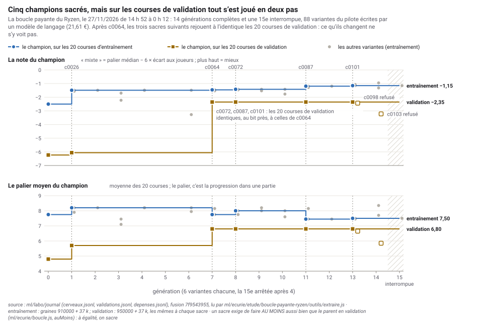

# La boucle payante du Ryzen : l'histoire d'une lignée de pilotes

Étude du 28/11/2026 (le lot « lignée », dossier `ml/ecurie/etude/boucle-payante-ryzen/`). Tout vient des journaux du labo copiés dans git par
la fusion `7f9543955`. Aucune course n'a été jouée pour cette étude, rien n'a été payé, et le jeu ne change pas.

## En une minute

Le 27 novembre, de 14 h 52 à minuit passé, un second ordinateur (« le Ryzen ») a fait tourner une boucle simple. Un modèle de langage
(Claude Sonnet) **réécrit le programme** qui conduit la voiture du jeu, le vrai jeu fait courir chaque version, on garde la meilleure et on recommence.
En 15 tours (« générations »), le modèle a écrit **88 versions** du pilote, pour **21,61 €**. Cinq ont été **sacrées** championnes l'une après l'autre :
c0026, c0064, c0072, c0087, c0101.

L'image tient en une phrase : **sur les courses gardées pour vérifier, tout s'est joué en deux pas.** Le premier champion (c0026)
apprend à ne pas rester coincé sous la route ; le deuxième (c0064) garde le turbo allumé quand il quitte la route par le bord, comme le font les joueurs.
Les trois suivants (c0072, c0087, c0101) changent du code qui **ne s'est déclenché dans aucune** des 20 courses de vérification : ils y
conduisent exactement comme c0064, image par image. Ils ont été sacrés parce que la règle accepte l'égalité, et parce qu'ils faisaient un peu mieux
sur les 20 courses d'entraînement, sur 1 ou 2 courses à chaque fois.

Ce qu'on sait : c0101 conduit autrement que le pilote de départ, et c'est, des cinq champions, celui qui a la meilleure note d'entraînement
(en validation, il est à égalité exacte avec c0064, c0072 et c0087). *(Corrigé le 28/11 par le relecteur : le texte disait « la meilleure note
sur les 40 courses » ; deux variantes refusées, c0098 et c0103, avaient une meilleure note d'entraînement que lui.)* Ce qu'on ne sait pas :
si c'est un vrai progrès. Les 40 courses ont toutes servi à choisir, et la différence (un peu moins d'un palier en moyenne) reste dans la marge
du hasard. La mesure sur des courses jamais vues (« le coffre », faite par une autre étude dans `coffre/`) tranchera.

(version sombre : `ml/ecurie/portfolio/images/boucle-payante-lignee-sombre.svg`)

## Les mots

- **Le pilote** : un fichier JavaScript d'environ 400 lignes qui regarde la route et appuie sur les touches. Le premier, c0025, est
  `ml/ecurie/pilote-voltige.js` (identique au caractère près, contrôlé par `outils/extraire.js`). C'est « le témoin » de la sélection naturelle.
- **Une graine** : le numéro qui fixe une partie (les cartes, le décor). Même pilote et même graine, c'est la même course au bit près.
- **Le palier** : jusqu'où la voiture est allée dans une partie. **L'écart aux joueurs** : à quel point sa conduite diffère de celle
  des vrais joueurs (0 = au milieu d'eux). **La note « mixte »** = palier médian − 6 × écart. Plus haut = mieux.
- **L'entraînement** : 20 graines (910000, 910037, …), toujours les mêmes. **Le tri** : les 6 premières, en 10 minutes au plus.
  **La validation** : 20 autres graines (950000, 950037, …), toujours les mêmes elles aussi.
- **Un sacre** : une variante devient le nouveau parent. Il faut qu'elle batte son parent à l'entraînement **et** qu'elle fasse au moins
  aussi bien que lui en validation.

## 1. La lignée, génération par génération

Recalculé par `outils/extraire.js` (sortie complète dans `donnees/tableaux.md` et `donnees/lignee.json`). Heures de Paris.
« Jumelles du parent » : variantes promues dont les 20 courses d'entraînement sont **identiques au bit près** à celles du parent (leur changement
ne s'est jamais déclenché).

| gén. | fin | parent | écrites | perdues | triées | promues (20 graines) | dont jumelles du parent | battent le parent | validées | sacre | euros |
|---|---|---|---|---|---|---|---|---|---|---|---|
| 0 | 14:52 | — | 0 | 0 | 0 | — | — | — | — | (c0025 noté) | 0,00 |
| 1 | 15:17 | c0025 | 6 | 0 | 6 | c0026, c0029 | — | c0026, c0029 | c0026 (tient) | **c0026** | 1,41 |
| 2 | 15:45 | c0026 | 6 | 0 | 6 | c0036 | c0036 | — | — | — | 1,44 |
| 3 | 16:10 | c0026 | 6 | 0 | 6 | c0038, c0040 | — | — | — | — | 1,46 |
| 4 | 16:36 | c0026 | 6 | 0 | 6 | c0047, c0048 | c0047, c0048 | — | — | — | 1,48 |
| 5 | 16:53 | c0026 | 6 | 0 | 6 | — | — | — | — | — | 1,47 |
| 6 | 17:24 | c0026 | 6 | 0 | 6 | c0057, c0059 | c0059 | — | — | — | 1,45 |
| 7 | 17:50 | c0026 | 6 | 0 | 6 | c0062, c0064 | — | c0064 | c0064 (tient) | **c0064** | 1,45 |
| 8 | 18:24 | c0064 | 6 | 0 | 6 | c0070, c0072 | c0070 | c0072 | c0072 (tient) | **c0072** | 1,45 |
| 9 | 18:57 | c0072 | 6 | 0 | 6 | c0076, c0077 | c0076 | — | — | — | 1,51 |
| 10 | 19:23 | c0072 | 6 | 0 | 6 | c0083, c0084 | c0084 | — | — | — | 1,51 |
| 11 | 21:42 | c0072 | 6 | 0 | 6 | c0087, c0089 | — | c0087, c0089 | c0087 (tient) | **c0087** | 1,48 |
| 12 | 22:08 | c0087 | 6 | 1 | 5 | c0095 | c0095 | — | — | — | 1,29 |
| 13 | 23:10 | c0087 | 6 | 0 | 6 | c0098, c0101 | — | c0098, c0101 | c0098 (ne tient pas), c0101 (tient) | **c0101** | 1,54 |
| 14 | 23:47 | c0101 | 6 | 0 | 6 | c0103, c0108 | — | c0103 | c0103 (ne tient pas) | — | 1,57 |
| 15 (interrompue) | 00:12 | c0101 | 4 | 0 | 4 | c0112 | c0112 | — | — | — | 1,10 |
| **total** | | | **88** | 1 | 87 | 25 | 9 | 9 | 7 | 5 | **21,61** |

- **L'argent, recontrôlé** : les 88 lignes de l'étape C2 de `depenses.jsonl` font **21,61 €** (somme exacte, et la somme génération par génération
  retombe dessus) ; tout le journal fait **58,53 €**. Un seul modèle, `claude-sonnet-5-5`, effort « high » ; 7,30 millions de jetons lus,
  1,78 million écrits. Une génération coûte 1,29 à 1,57 €, une variante 0,20 à 0,42 €. Ce sont des **estimations** faites par la boucle
  à partir des jetons (1 € compté pour 1 $) : la facture fait foi.
- **La variante perdue** (génération 12) : la connexion a coupé pendant la réponse (« reseau : terminated »), 0 € compté.
- **Les deux échecs en validation** : c0098 (gén. 13) battait c0087 à l'entraînement (−1,07 contre −1,19) ; en validation il change **une** course sur 20
  (graine 950629 : palier 10 → 7) et tombe à −2,43 contre −2,35 : refusé. La boucle a alors essayé la suivante, c0101, qui a tenu.
  c0103 (gén. 14, `dessousMax` 0,4 → 0,2 s) change 10 courses d'entraînement (−1,15 → −0,95) mais 6 de validation, dont trois très mal
  (14 → 5, 11 → 5, 10 → 3) : −3,22, refusé.
- **La génération 15** : arrêtée à 0 h 12 pour laisser le Ryzen à la sélection naturelle. Quatre variantes écrites (c0109 à c0112, 1,10 €), triées ;
  seule c0112 a été notée sur 20 graines, et ses 20 courses sont celles de c0101 au bit près. Pas de ligne de clôture dans `generations.jsonl`.
- **Une pause** : rien entre 19 h 23 et 21 h 34 (entre les générations 10 et 11). Le journal ne dit pas pourquoi.
  *(Précisé le 28/11 par le relecteur : ce trou de 2 h 11 contient aussi le travail de la génération 11, qui n'écrit ses lignes qu'à la fin ;
  une génération prend 17 à 62 minutes d'après la colonne « fin », la vraie pause est donc d'environ 1 h 10 à 1 h 50.)*
- **Neuf promues sur vingt-cinq étaient des jumelles** : leur changement ne s'est déclenché dans aucune des 20 courses d'entraînement.
  La boucle les a quand même notées en grand (20 courses de 15 minutes au plus chacune), pour rien.

## 2. Ce que chaque champion a changé

Pour chaque sacre : ce que la boucle avait demandé au modèle (l'« angle », `echanges/<id>.json.gz`), ce qu'il a dit vouloir faire (sa « raison »),
le code réellement changé (`diffs/<parent>-<enfant>.diff`), et ce que ça change dans la conduite.

### c0026 (gén. 1, parent c0025, 0,38 €) : sortir de sous la route

- **On lui demandait** : rouler moins souvent *sous* la route suspendue (les joueurs y passent 2 % du temps au sol, par passages d'une seconde).
- **Il a dit** : « Une seule idée, le dessous de la dalle. » Pénaliser davantage une arrivée sous la route, la fuir tout de suite en vol, en ressortir plus vite au sol.
- **En clair** : quand la voiture se retrouve sous la route, elle cherche la sortie au bout de 0,4 seconde au lieu de 0,8 ; et en l'air,
  elle préfère franchement atterrir dessus plutôt que dessous.
- **Courses** : 15 des 20 courses d'entraînement et 9 des 20 de validation changent. Validation : palier moyen 4,80 → 5,70, note −6,23 → −6,06.

### c0064 (gén. 7, parent c0026, 0,20 €) : décoller turbo allumé

- **On lui demandait** : « s'envoler au lieu de tomber ». Les joueurs ont le turbo (la nitro) allumé 63 fois sur 100 quand ils quittent la route ; le pilote, 17.
- **Il a dit** : sur les cartes sans décor (nuages, espace), quand le bord arrive dans moins de 0,7 s, garder la nitro jusqu'au décollage. « Je n'ai pas lancé la variante : l'effet n'est pas mesuré. »
- **En clair** : sur les cartes où tomber de la route ne tue pas, la voiture quitte le bord en accélérant au lieu de lever le pied, et vole donc plus loin.
- **Courses** : 16 sur 20 à l'entraînement, 12 sur 20 en validation. Validation : palier médian 4 → 6, palier moyen 5,70 → 6,80, écart 1,677 → 1,392,
  note −6,06 → **−2,35**. C'est **le seul grand saut** de la validation.

### c0072 (gén. 8, parent c0064, 0,22 €) : des figures quand la marge est large

- **On lui demandait** : plus de figures en vol (les joueurs : 3,3 par minute), mais seulement dans les vols où c'est sans danger.
- **Il a dit** : le parent n'ose une figure qu'à plus de 15 m de la route, ce qui n'arrive presque jamais ; ajouter un cas « marge large » (atterrissage annoncé loin, propre, droit, à au moins 9 m de haut), jusqu'à trois figures par vol.
- **En clair** : sur les cartes sans décor, dans les longs vols sûrs, la voiture se permet des acrobaties.
- **Courses** : **1** course d'entraînement change (graine 910444 : palier 14 → 19), **0** en validation.

### c0087 (gén. 11, parent c0072, 0,21 €) : garder le turbo dans les virages

- **On lui demandait** : la nitro au sol (les joueurs l'ont 78 % du temps), en choisissant mieux *où* la couper.
- **Il a dit** : sur les cartes sans décor, une sortie de route ne coûte que de l'air ; y garder la nitro dans des virages 25 % plus serrés et à 5 % de vitesse en plus.
- **En clair** : sur les nuages et dans l'espace, la voiture lâche moins souvent l'accélérateur dans les courbes.
- **Courses** : **2** courses d'entraînement changent, l'une en mieux (910629 : 6 → 8), l'autre **beaucoup en moins bien** (910444 : 19 → 6, la meilleure
  course de c0072 perdue) ; **0** en validation. La note monte quand même (−1,42 → −1,19) parce que l'écart aux joueurs baisse (1,570 → 1,531),
  alors que le palier moyen baisse (8,00 → 7,45).

### c0101 (gén. 13, parent c0087, 0,22 €) : des figures plus bas

- **On lui demandait** : le même angle que c0072, les figures.
- **Il a dit** : la condition de hauteur (9 m) bloque presque tout ; la ramener à 4 m, les autres protections restant. « L'effet n'est pas mesuré. »
- **En clair** : les acrobaties de c0072 sont permises plus près de la route.
- **Courses** : **1** course d'entraînement change (910703 : 8 → 9), **0** en validation.

Les trois derniers ne touchent que les cartes sans décor (nuages, espace). Ce n'est pas que ces cartes manquent : 13 des 20 courses de validation
y passent (ces 13 courses durent 35 minutes en tout, dont une partie seulement sur ces cartes). C'est que les conditions réunies par le nouveau code ne s'y présentent jamais assez pour changer **une seule image**
(l'« empreinte » d'une course hache, à chaque image, la position, la vitesse, la nitro et l'argent : `ml/bot/piloter.js`).
*(Corrigé le 28/11 par le relecteur : le texte disait « 40 minutes de jeu en tout » ; 40 minutes, c'est la durée des 20 courses de validation
de c0064, pas des 13 qui passent par les cartes sans décor : 2 111 s.)*
**Rares, pas impossibles** *(ajouté le 28/11 par le relecteur)* : chacun des trois change au moins une course d'entraînement (c0072 : 910444,
où les figures payées passent de 21 à 39 ; c0087 : 910444 et 910629 ; c0101 : 910703). Le jeu étant déterministe et seul le fichier du pilote
changeant, c'est que leur nouveau code a agi au moins une fois : les règles `largeOn` et `libreOn` ne sont pas inertes. Elles agissent sur
1 ou 2 courses sur 40. Pourquoi si rarement (quelle condition bloque), ça n'a pas été cherché.

### Le tableau technique, pour le portage

Tous les changements sont dans `REGLAGES` (les constantes), `auSol(v,m)` (la conduite au sol) et `enVol(v,m)` (la conduite en l'air).
Les noms de gènes de la dernière colonne sont ceux de `ml/evolution/genome.js` **tel qu'il était dans l'arbre de travail le 28/11 vers 0 h 50**
(modifié, pas encore commité, par un autre travail) : à recontrôler contre la version qui sera commitée.

| sacre | où | quoi | avant | après | gène (genome.js) |
|---|---|---|---|---|---|
| c0026 | `REGLAGES.dessousMax` | s sous la dalle avant de chercher la sortie par le bord | 0,8 | 0,4 | `dessousMax` (existait) |
| c0026 | `REGLAGES.dessousPose` | points perdus par une pose annoncée sous la dalle | 25 | 40 | `dessousPose` (existait) |
| c0026 | `enVol`, condition de changement de façon | fuir une façon qui mène sous la dalle **sans attendre** `tenirFacon` (0,35 s) | `depuis>R.tenirFacon\|\|…` | `depuis>R.tenirFacon\|\|fuit\|\|…` | interrupteur `fuirVite` |
| c0064 | `REGLAGES.bordNitro` (nouveau) | s avant le bord sous lesquelles la nitro reste tenue | — | 0,7 | `bordNitro` |
| c0064 | `REGLAGES.bordJauge` (nouveau) | jauge + réserve minimale pour ce décollage | — | 0,5 | `bordJauge` |
| c0064 | `auSol`, après le calcul de `m.nitro` | nouvelle ligne : `if(!decor&&lache&&!v.dessous&&!v.glisse&&!v.rebond&&tn.t!=null&&tn.t<R.bordNitro&&jauge>R.bordJauge)m.nitro=true;` | — | ajoutée | interrupteur `bordOn` |
| c0072 | `REGLAGES.largeHaut` … `largeMax` (nouveaux) | hauteur mini, délais avant la pose (1re figure, suivantes), angle d'arrivée, air restant, figures par vol | — | 9 m ; 2,2 s ; 1,8 s ; 0,5 rad ; 1,5 s ; 3 | `largeHaut`, `largeT1`, `largeT2`, `largeAxe`, `largeAir`, `largeMax` |
| c0072 | nouvelle fonction `poseNette(r,axeMax)` | une pose propre, dessus, sous l'angle donné | — | ajoutée | (dans `largeOn`) |
| c0072 | `enVol`, décision de lancer une figure | `parentOk`, `large`, `nMax`, `tSeuil` ; la condition finale `(m.voulu\|\|(f.proche&&f.proche.haut>R.figHaut&&!DECOR[v.carte]))` devient `(parentOk\|\|large)` | règle du parent | règle du parent OU marge large | interrupteur `largeOn` |
| c0087 | `REGLAGES.nitroLibreK` (nouveau) | multiplicateur du seuil de volant, nitro déjà allumée, carte sans décor | (1) | 1,25 | `nitroLibreK` |
| c0087 | `REGLAGES.tenirLibre` (nouveau) | part de vitesse tolérée au-dessus de `vSure` pour garder la nitro, carte sans décor | (0) | 0,05 | `tenirLibre` |
| c0087 | `auSol`, `k` et `sur` | `k=decor?R.nitroDecor:1` → `k=decor?R.nitroDecor:(m.nitro?R.nitroLibreK:1)` ; nouveau `mTenir=decor?R.margeTenir:R.margeTenir-R.tenirLibre` remplace `R.margeTenir` dans `sur` | | | interrupteur `libreOn` |
| c0101 | `REGLAGES.largeHaut` | hauteur mini d'une figure à marge large | 9 | 4 | `largeHaut` |

Deux changements sur cinq ne sont que des **réglages** (c0026 en partie, c0101) ; les trois autres **ajoutent du code** : une règle nouvelle,
avec ses propres constantes. C'est ce que des mutations de réglages ne savent pas faire (voir la partie 5).

## 3. Le point délicat : quatre champions, une seule conduite en validation

### Ce que dit le code

Dans `ml/ecurie/boucle.js` (lignes 92 à 94 et 289 à 303) :

- une note se compare comme un triplet `[mixte, palier record, survie médiane]`, dans l'ordre (`valeur`, `mieux`) ;
- une variante n'est **validée** que si elle bat **strictement** son parent à l'entraînement (`mieux`) ;
- elle est **sacrée** si, sur les 20 graines de validation, elle fait **au moins aussi bien** que son parent sur ces mêmes graines (`auMoins(x,y) = !mieux(y,x)`) ;
- la « barre » du parent est sa propre note de validation, relue au journal.

**À égalité parfaite en validation, on sacre.** Et comme les graines de validation sont toujours les mêmes et que le jeu est déterministe,
une variante dont le changement ne s'y déclenche pas fait *exactement* la note de son parent : elle passe toujours.

### Ce que disent les chiffres (recontrôlés)

L'observation de départ est juste : c0064, c0072, c0087 et c0101 ont les **mêmes 20 courses de validation, empreinte par empreinte**,
donc les mêmes paliers, le même écart (1,392) et la même note (−2,35). c0025 : palier moyen 4,80, écart 1,705, note −6,23 ; c0026 : 5,70, 1,677, −6,06.

| pilote | parent | entraînement : mixte | palier médian | palier moyen | record | écart | validation : mixte | palier médian | palier moyen | record | écart | courses changées (entr. / valid.) |
|---|---|---|---|---|---|---|---|---|---|---|---|---|
| c0025 | — | −2,50 | 7,5 | 7,75 | 14 | 1,666 | −6,23 | 4 | 4,80 | 9 | 1,705 | — |
| c0026 | c0025 | −1,49 | 8 | 8,20 | 17 | 1,581 | −6,06 | 4 | 5,70 | 14 | 1,677 | 15 / 9 |
| c0064 | c0026 | −1,46 | 8 | 7,75 | 14 | 1,577 | −2,35 | 6 | 6,80 | 16 | 1,392 | 16 / 12 |
| c0072 | c0064 | −1,42 | 8 | 8,00 | 19 | 1,570 | −2,35 | 6 | 6,80 | 16 | 1,392 | 1 / 0 |
| c0087 | c0072 | −1,19 | 8 | 7,45 | 14 | 1,531 | −2,35 | 6 | 6,80 | 16 | 1,392 | 2 / 0 |
| c0101 | c0087 | −1,15 | 8 | 7,50 | 14 | 1,525 | −2,35 | 6 | 6,80 | 16 | 1,392 | 1 / 0 |
| c0098 (refusé) | c0087 | −1,07 | 8 | 7,45 | 14 | 1,511 | −2,43 | 6 | 6,65 | 16 | 1,405 | 1 / 1 |
| c0103 (refusé) | c0101 | −0,95 | 8 | 7,70 | 13 | 1,491 | −3,22 | 5,5 | 5,85 | 16 | 1,453 | 10 / 6 |

**Ce qui distinguait c0064, c0072, c0087 et c0101 à l'entraînement** (notes −1,46, −1,42, −1,19, −1,15) : toujours les **mêmes 20 graines**
(910000 et suivantes), et à chaque pas **une ou deux courses** différentes du parent. Le palier médian ne bouge pas (8 partout) ; tout le gain de note
vient de l'écart aux joueurs (1,577 → 1,525), qui se calcule sur l'ensemble des parties, si bien qu'une seule course différente le déplace.
Le palier moyen, lui, **baisse** de c0064 à c0101 (7,75 → 7,50), et c0087 a été sacré en perdant la meilleure course de c0072 (19 → 6).

**Le palier, course par course sur les mêmes graines** (enfant − parent, moyenne ± erreur type ; un t de 2 ou plus serait difficile à mettre
sur le compte du hasard) :

| pilote | contre | entraînement (20) | validation (20) | les 40 |
|---|---|---|---|---|
| c0026 | c0025 | +0,45 ± 0,88 (t 0,5) | +0,90 ± 0,58 (t 1,5) | +0,68 ± 0,52 (t 1,3) |
| c0064 | c0026 | −0,45 ± 0,79 (t −0,6) | +1,10 ± 0,75 (t 1,5) | +0,33 ± 0,55 (t 0,6) |
| c0072 | c0064 | +0,25 ± 0,25 (t 1,0) | 0 (identiques) | +0,13 ± 0,13 |
| c0087 | c0072 | −0,55 ± 0,66 (t −0,8) | 0 (identiques) | −0,28 ± 0,33 |
| c0101 | c0087 | +0,05 ± 0,05 (t 1,0) | 0 (identiques) | +0,03 ± 0,02 |
| **c0101** | **c0025 (le témoin)** | **−0,25 ± 1,02 (t −0,2)** | **+2,00 ± 0,68 (t 2,9)** | **+0,88 ± 0,63 (t 1,4)** |

### Progrès réel, ou bruit ?

- **c0072, c0087, c0101 : rien ne montre un progrès.** Leur changement ne joue sur aucune des 20 courses de validation et sur 1 ou 2 des 20
  d'entraînement. Un pas de note de 0,04 à 0,23 sur une ou deux courses est **plus petit que le bruit** : une autre étude du dépôt
  (`ml/ecurie/etude/selection-naturelle/bruit/resultats.txt`) mesure qu'entre deux lots de graines, la différence de note mixte entre deux pilotes
  varie d'environ 2 (écart-type, sur 12 courses de 300 s : un ordre de grandeur, pas les mêmes conditions). Et ces 20 graines ont servi à **choisir**
  à chaque génération : le modèle recevait même l'autopsie des pires courses du parent sur ces graines. C'est la définition du **sur-apprentissage** :
  un pilote ajusté à 20 parties précises.
- **c0026 et c0064 : peut-être, mais rien de sûr.** Leurs changements jouent sur beaucoup de courses (9 à 16 sur 20). En validation, chacun gagne
  environ un palier moyen (t 1,5) ; à l'entraînement, c0064 *perd* un demi-palier sur c0026. Un piège s'ajoute : c0025 était **malchanceux** sur
  les graines de validation (palier moyen 4,80 contre 7,75 à l'entraînement). Un changement qui modifie beaucoup de courses, c'est presque
  un nouveau tirage : sur des graines où le parent avait été malchanceux, il tend à faire mieux, sur celles où il avait été chanceux, moins bien.
  C'est exactement le motif qu'on voit (c0064 : moins bien à l'entraînement, mieux en validation ; c0103 : l'inverse).
- **c0101 contre le témoin** : sur les 40 graines, +0,88 palier moyen ± 0,63, pas décisif. Le +2,00 de la validation seule est **gonflé** :
  ces graines ont servi à trier (c0098 et c0103 refusés, les sacres acceptés, sur elles), ce n'est donc plus une mesure neuve.
  À l'entraînement, c0101 ne fait pas mieux que c0025 en palier (−0,25) ; sa note y est meilleure surtout par l'écart aux joueurs
  (1,666 → 1,525, soit +0,85 de note sur les +1,35).

**Ce qu'on sait** : la boucle a bien produit un pilote différent, qui ressemble un peu plus aux joueurs sur ces 40 courses, et dont trois des
cinq changements sont du code neuf. **Ce qu'on ne sait pas** : s'il est meilleur ailleurs que sur ces 40 courses. **Ce que le coffre tranchera**
(graines 990000 et suivantes, jamais jouées par la boucle) : (1) si c0064 et c0101 y font la même chose, les trois derniers sacres sont neutres ;
(2) si c0064/c0101 battent c0025 (et c0026) d'au moins un palier sur assez de courses, le saut de c0064 était réel ; (3) l'écart aux joueurs
de chacun, pour savoir si le gain de « ressemblance » tient hors des graines d'entraînement.

## 4. L'image

`outils/figure.js` écrit `ml/ecurie/portfolio/images/boucle-payante-lignee-clair.svg` et `-sombre.svg` (conventions de
`ml/ecurie/portfolio/figures-journal/depenses.js` : palette, police, contrôle qu'aucun texte n'en chevauche un autre). En haut la note du champion,
en bas son palier moyen ; bleu (ronds) = les 20 courses d'entraînement, ambre (carrés) = les 20 de validation ; points gris = les autres variantes
notées sur 20 courses ; carrés vides = les deux refusés ; traits pointillés = les sacres ; hachures = la génération 15 interrompue.
Les deux couleurs ont passé le contrôle de couleurs (daltonisme, contraste) en clair et en sombre. Rendue et regardée dans Chrome sans écran.

## 5. Trois leçons pour la sélection naturelle

1. **Elle a su changer du code, pas seulement des réglages.** Trois des cinq sacres ajoutent une règle qui n'existait pas (décoller nitro tenue,
   figures à marge large, nitro gardée en virage), avec ses constantes. Une mutation de réglages ne peut que bouger les nombres d'une règle existante :
   elle n'aurait pas inventé `bordNitro`. Le portage dans `genome.js` (interrupteurs `bordOn`, `largeOn`, `libreOn`, `fuirVite`) fait de ces inventions
   des gènes que la sélection peut ensuite régler gratuitement : c'est la bonne division du travail, *si* ces règles valent quelque chose (le coffre le dira).
2. **Elle a coûté 21,61 € et une soirée de processeur pour un gain qu'on ne peut pas encore affirmer.** 88 variantes, 25 notées en grand,
   9 de ces 25 identiques à leur parent (notées pour rien), 5 sacres dont 3 invisibles en validation. Environ 1,45 € et 30 minutes par génération.
   La sélection naturelle, elle, ne paie que l'électricité.
3. **Le piège : les mêmes graines rejouées.** Entraînement et validation étaient chacun **les mêmes 20 graines** du début à la fin, et
   l'égalité suffisait pour sacrer. À refaire : (a) des graines de validation **neuves à chaque sacre** (ou un coffre jamais touché) ;
   (b) une égalité parfaite en validation = **pas de sacre** (rien n'a été montré) ; (c) écarter avant la note en grand une variante dont les courses
   de tri sont identiques au parent ; (d) comparer le palier course par course, pas seulement une note où un seul chiffre agrégé (l'écart) bouge
   pour une course. La sélection naturelle de `ml/evolution/` prévoit déjà un coffre et des graines nouvelles (`INTERFACES.md`) ; l'étude
   `../reglage-de-la-selection/sacre/` propose un test séquentiel pour le sacre.

## Ce que je n'ai pas vérifié

- Pourquoi les changements de c0072, c0087, c0101 ne se déclenchent presque jamais. Pas de course rejouée. *(Le relecteur, 28/11 : « condition
  impossible » est exclu, chacun change au moins une course d'entraînement ; reste à savoir quelle condition les rend si rares.)*
- Les montants en euros : ce sont les estimations de la boucle (jetons × tarif), pas la facture.
- La comparaison au bruit cite une autre étude faite dans d'autres conditions (12 courses de 300 s, d'autres pilotes) : un ordre de grandeur.
- Le « t » du palier apparié suppose des différences indépendantes d'une graine à l'autre ; avec 20 graines et des paliers très dispersés, c'est approximatif.
- Les noms de gènes de `genome.js` : lus dans un fichier en cours de modification.
- Les heures : l'heure UTC du journal + 1 h.

## Relecture (28/11/2026, le relecteur)

Méthode : relu le texte ligne à ligne contre les journaux ; relancé `extraire.js` (tous les contrôles tiennent, sortie identique au bit près
d'un lancement à l'autre) et `figure.js` (SVG identiques) ; rendu les deux SVG dans Chrome sans écran et regardé ; **recalculé par un script
à moi, sans passer par `extraire.js`**, à partir des fichiers bruts de `ml/labo/journal/` : 88 inscriptions C2, 88 dépenses pour 21,61 €
(58,53 € en tout), les euros par génération, 25 promues dont 9 jumelles, les sacres, les empreintes de validation identiques pour c0064, c0072,
c0087, c0101, toutes les notes du grand tableau, les courses changées graine par graine, le palier apparié c0101 − c0025 (−0,250 ± 1,021 ;
+2,000 ± 0,684 ; +0,875 ± 0,633), tmax 900 s (600 s au tri, 6 graines), graines de 37 en 37. Relu la règle du sacre dans `boucle.js`
(`valeur`, `mieux`, `auMoins`, `barreDe`, le bloc de validation) : juste. Relu les cinq diffs contre le tableau de portage : juste ; les noms
de gènes existent dans `genome.js` (arbre de travail) et `dessousMax`, `dessousPose` existaient déjà dans la version commitée. Les citations
du modèle et les chiffres des « angles » (63/17 %, 3,3 figures par minute, 78 %, 2 %) sont bien dans `echanges/` et `cerveaux.jsonl`.
Le « bruit ≈ 2 » est bien dans `selection-naturelle/bruit/resultats.txt` (mixte, graines communes, 2,00).

Ce qui était faux, corrigé dans le texte (marqué) :
1. « 13 des 20 courses de validation y passent (40 minutes de jeu en tout) » : les 40 minutes sont la durée des 20 courses ; les 13 durent 35 minutes,
   et pas entièrement sur les cartes sans décor.
2. « c0101 a la meilleure note sur les 40 courses » : la note mixte ne se calcule pas sur 40 courses réunies, et c0098, c0103 avaient une meilleure
   note d'entraînement ; c0101 a la meilleure des cinq champions.
3. La « pause » de 19 h 23 à 21 h 34 contient le travail silencieux de la génération 11 : vraie pause plus courte (précisé).

Ce qui était laissé ouvert et que la relecture tranche : les règles de c0072, c0087 et c0101 **ne sont pas impossibles** (chacune change au moins
une course d'entraînement). Les gènes `largeOn` et `libreOn` ne sont donc pas inertes, seulement rares (1 ou 2 courses sur 40).

Ce qui reste, que je n'ai pas corrigé :
- Les « t » des pas c0072, c0087, c0101 (tableau du palier apparié) reposent sur 1 ou 2 différences non nulles sur 20 : un t n'y a pas de sens,
  il faut lire « une ou deux courses ont changé », rien de plus.
- « c0025 était malchanceux sur les graines de validation » est une lecture, pas une mesure : toutes les variantes ont un palier moyen plus bas
  en validation qu'à l'entraînement (c0101 : 6,80 contre 7,50 ; c0103 : 5,85 contre 7,70), ces graines sont peut-être simplement plus dures.
  Si elles le sont pour tout le monde, l'argument du retour à la moyenne s'affaiblit. Les deux lectures restent ouvertes.
- Le coffre (`coffre/`, une autre étude) n'est **pas fini** : à 0 h 43, 4 graines sur 40 jouées par les quatre pilotes, rien de concluant ;
  sur ces 4 graines, c0064 et c0101 jouent encore exactement les mêmes courses.
- Le contrôle de daltonisme et de contraste des couleurs n'a pas été refait par moi ; l'image, regardée, est lisible en clair et en sombre.
- Les montants restent des estimations de la boucle, pas la facture.

## Les fichiers

- `outils/extraire.js` : lit les journaux, contrôle (sacres, 21,61 €, 58,53 €, témoin = pilote-voltige.js, validations identiques), écrit `donnees/` et `diffs/`.
- `outils/figure.js` : l'image, à lancer après `extraire.js`.
- `donnees/lignee.json` : tout, génération par génération et pilote par pilote ; `donnees/tableaux.md` : les tableaux recalculés.
- `diffs/<parent>-<enfant>.diff` : le code changé par chaque sacre (fins de ligne ignorées).
- `NOTE-INTEGRATEUR.md` : pour qui reprend.
- `coffre/` : l'autre étude (la mesure sur des graines jamais vues), pas de moi.
